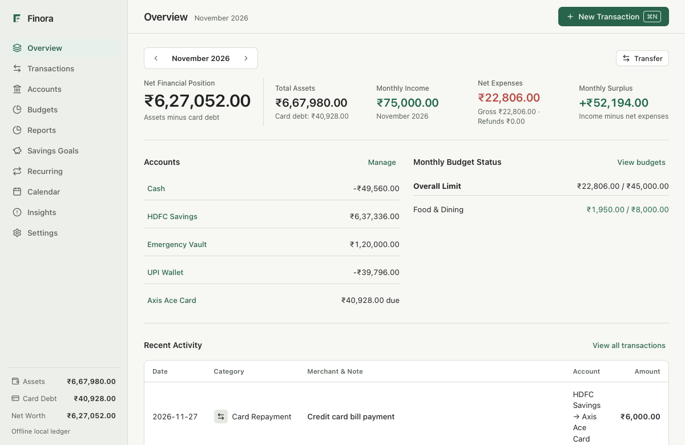
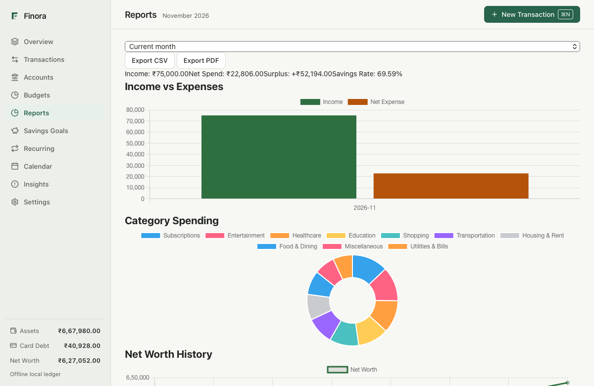
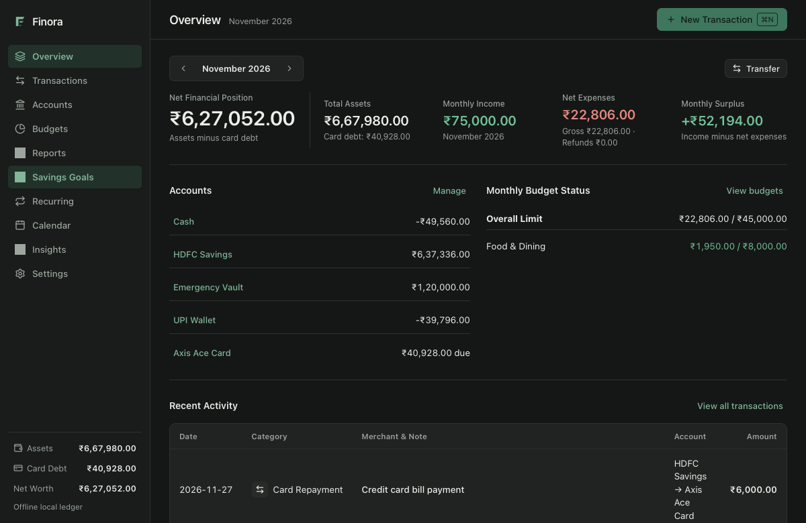

# Finora

Finora is a local-first personal finance application for macOS, built with Python, Flask, and SQLite. It combines multi-account expense tracking, monthly budgeting, interactive reports, savings goals, and recurring payments in a standalone desktop application without cloud accounts or telemetry.



## Features

- **Ledger & Accounts**: Exact integer-paise arithmetic (`Decimal` input parsing), 5 account types (`cash`, `bank`, `savings`, `wallet`, `credit_card`), internal transfers, credit card repayments, split transactions, and linked partial/full refunds.
- **Monthly Budgets**: Ten predefined expense categories, custom categories, independent overall spending caps, and up-to-60-month rollover.
- **Interactive Reports**: Locally bundled Chart.js (`4.4.7`) visualizations, period comparisons, and category/merchant breakdowns.
- **Savings Goals & Recurring**: Ledger-backed goal allocations, recurring rules with calendar anchor preservation, and subscription cost tracking.
- **Insights & Calendar**: Deterministic, explainable advisory rules, pace-based monthly forecasts, and a monthly financial calendar.
- **Portability & Backups**: Bounded CSV import/export (formula-injection safe), offline PDF 1.4 reports, SHA-256 ZIP backups with staged restoration, and an isolated synthetic demo workspace.

## Screenshots

| Reports | Dark Mode Overview |
| :--- | :--- |
|  |  |

## Installation (Apple Silicon macOS)

1. Download `Finora-v1.0.0-macos-arm64.zip` and `SHA256SUMS.txt` from the GitHub Release.
2. Verify the checksum: `shasum -a 256 -c SHA256SUMS.txt`.
3. Extract the archive and move `Finora.app` to Applications.

> **Signing & Gatekeeper Note**: Packaged builds use local ad-hoc code signing (`codesign --force --deep --sign -`) and are **not** signed with an Apple Developer ID certificate or notarized by Apple. macOS Gatekeeper may block or warn on downloaded copies; you can run Finora directly from source below as a zero-trust alternative.

## Running from Source

```bash
git clone https://github.com/axhutoshhhh/finora.git
cd finora
python3 -m venv .venv
source .venv/bin/activate
pip install -r requirements-dev.lock
playwright install webkit
.venv/bin/python main.py
```

## Architecture & Financial Accuracy

- **Desktop & API**: `pywebview` (`WKWebView`) → Loopback-only Waitress/Flask API (`127.0.0.1`) protected by a per-launch `X-Finora-Token`, `X-Finora-Workspace-Gen`, `Host`/`Origin`/`Sec-Fetch-Site` checks, and strict CSP (`script-src 'self'`).
- **Storage**: Parameterized SQLite WAL ledger (`~/Library/Application Support/Finora/finance.sqlite3`) with `0700`/`0600` POSIX permissions. SQLite databases and ZIP backups are **not** encrypted at rest; reliance is on macOS FileVault and owner-only file permissions.
- **Documentation**: See [docs/project-evaluation/abstract-and-viva.md](docs/project-evaluation/abstract-and-viva.md), [docs/feature-verification-matrix.md](docs/feature-verification-matrix.md), [docs/qa/audit-remediation-matrix.md](docs/qa/audit-remediation-matrix.md), and [SECURITY.md](SECURITY.md).

## Performance & Testing

On a 10,000-transaction synthetic dataset (`benchmarks/benchmark_phase4.py`), Phase 4 SQLite composite indexing (`0004_phase4_indexes.sql`) and ES-module frontend loading reduced median Overview UI loading from **230.68 ms** (`v0.3.0`) to **129.32 ms** (`v1.0.0`, **-43.9%**), and 100,000-row Overview backend retrieval from **694.04 ms** to **332.02 ms** (**-52.2%**).

```bash
.venv/bin/pytest --cov=app --cov-branch -q
.venv/bin/ruff check . && .venv/bin/ruff format --check .
.venv/bin/bandit -r app desktop main.py
.venv/bin/pip-audit -r requirements.lock
```

## Known Limitations

- Tested on Apple Silicon (`arm64`) `macOS 27.0.1` (`Python 3.15.2`, `SQLite 3.53.4`); Intel (`x86_64`) builds are not provided.
- Native macOS trackpad resizing, Spaces transitions, and VoiceOver checks require manual human evaluation.

## License

MIT License — see [LICENSE](LICENSE) and [THIRD_PARTY_NOTICES.md](THIRD_PARTY_NOTICES.md).
