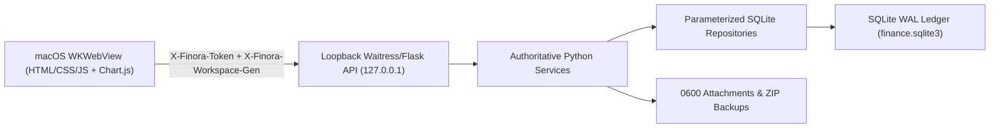
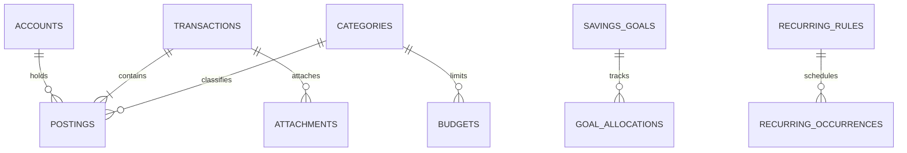

# Finora — University Evaluation, Architecture Diagrams & Viva Guide

## 1. Project Abstract
Finora is an offline-first, single-user personal finance management desktop application for macOS (Apple Silicon), built with Python, Flask, Waitress, SQLite, and `pywebview` (`WKWebView`). It provides multi-account expense/income tracking, internal transfers, credit card accounting, linked refunds, split transactions, monthly budgeting across ten predefined categories, interactive Chart.js reports, rule-based advisory insights, savings goals, recurring payments, CSV/PDF portability, SHA-256 ZIP backup/restoration, and an isolated synthetic demo workspace.

## 2. System Architecture Diagram

## 3. Core Entity-Relationship Diagram

## 4. Five-Minute Demonstration Walkthrough
1. Launch `Finora.app` (or `.venv/bin/python main.py` with `FINORA_DATA_DIR`).
2. Switch to the isolated **Demo workspace** to inspect 8 months of synthetic data without exposing personal records.
3. Walk through **Overview**, **Transactions** (filters, splits, refunds), **Accounts** (5 types + credit card debt), and **Budgets** (10 categories + rollover).
4. Open **Reports** (Chart.js offline visualizations), **Savings Goals**, **Recurring**, **Calendar**, and **Insights**.
5. Explain **Backup/Restore** (SHA-256 manifest + staged restore) and **Architecture** (integer paise, loopback token, `0004_phase4_indexes.sql`).

## 5. Selected Viva Q&A (Summary)
- **Why integer paise (`INTEGER`) instead of `FLOAT`?** Binary floating point introduces rounding drift (e.g. `0.1 + 0.2 != 0.3`). Finora parses inputs with `Decimal` and stores exact integer paise (`1 INR = 100`).
- **How are transfers excluded from income/expenses?** Transfers create two balancing postings (`-amount` and `+amount`) under `entry_type='transfer'`, which analytics and budget queries exclude from ordinary income and spending.
- **How is the local API secured without a login screen?** Waitress binds strictly to `127.0.0.1`, and `pywebview` injects a per-launch `X-Finora-Token` directly into a private JS closure while enforcing `Host`, `Origin`, `Sec-Fetch-Site`, and strict CSP (`script-src 'self'`).
- **How does `v1.0.0` optimize 100k queries?** Migration `0004_phase4_indexes.sql` adds composite covering indexes (`idx_transactions_active_date_id`, `idx_transactions_active_type_date`, `idx_postings_tx_acct_cat_amt`), cutting 100k `overview_load` from `694.04 ms` to `332.02 ms` (`-52.2%`) and 10k Overview UI loading from `230.68 ms` to `129.32 ms` (`-43.9%`).
